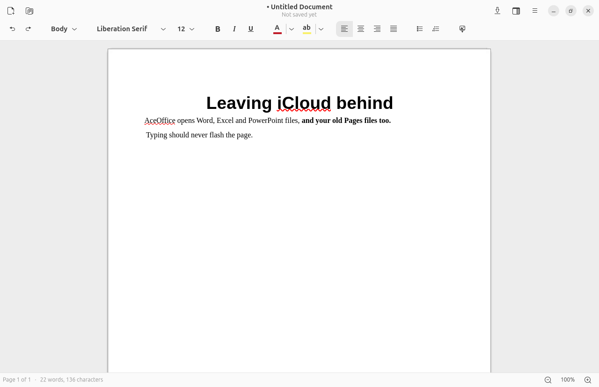
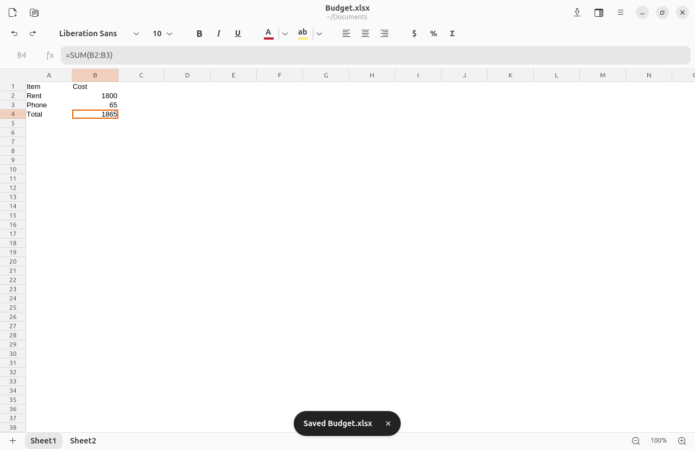
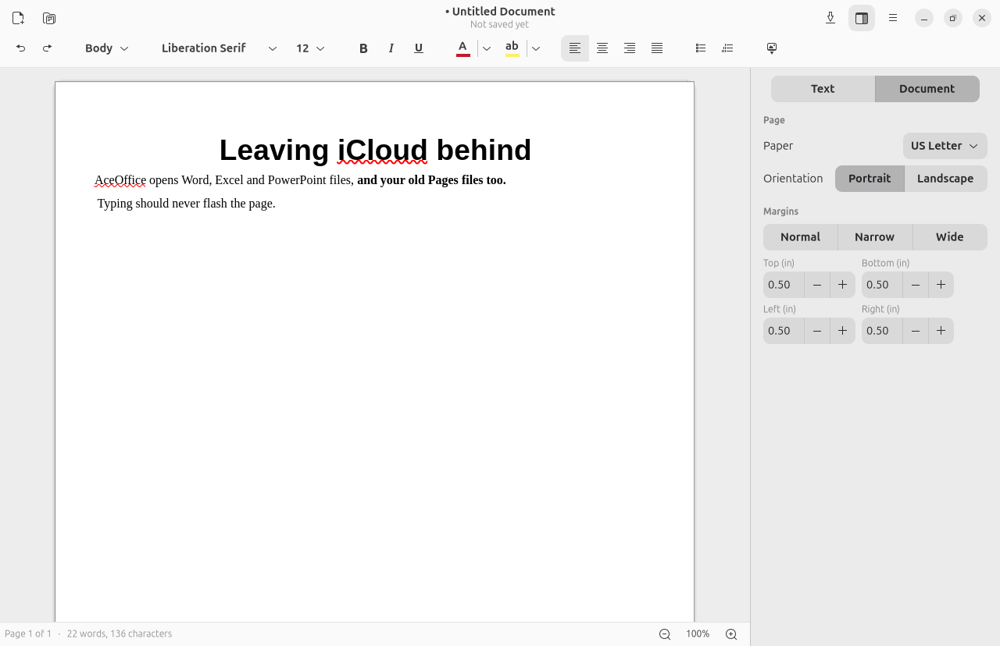

# AceOffice

A friendly office suite for Linux, made for people leaving the Apple ecosystem.

AceOffice is a native GNOME app (GTK 4 + libadwaita) that uses LibreOffice's
document engine, LibreOfficeKit, underneath. You get LibreOffice's compatibility
with Word and Excel files, and its Pages and Numbers importers, in an interface
that feels at home next to the rest of your desktop.





> **Early preview (0.1).** Documents and spreadsheets work. Presentations are
> switched off until slide rendering is fixed ([#1](https://github.com/androbot9000/aceoffice/issues/1)).

## What works

- **Documents:** type and format text (font, size, bold, italic, underline,
  strikethrough, text color and highlight, alignment, line spacing, indents, lists,
  paragraph styles), insert images, undo and redo, spell checking. The **Format sidebar**
  (Ctrl+Shift+F) has a Document tab for paper size, orientation and margins. The status
  bar shows the page and word count.
- **Spreadsheets:** row and column headers (click one to select the whole row or column),
  values and formulas, the formula bar, sheet tabs, fill color, number formats, decimal
  places, wrap and merge, and the Σ AutoSum button. New sheets start without gridlines;
  turn them on per sheet in the sidebar (files you open keep their own setting). Print
  margins, paper and orientation are in the sidebar too.
- **Files:** open `.docx .doc .odt .rtf .txt .xlsx .xls .ods .csv`, plus Apple
  **`.pages`** and **`.numbers`** files. iWork files are imported, and the first save
  writes a Word or Excel copy next to the original. New files save as `.docx`/`.xlsx`
  by default (or ODF if you prefer). Export any document to PDF.
- **Everyday stuff:** find (Ctrl+F), a right-click menu, a keyboard shortcuts window
  (Ctrl+?), a recent files list, unsaved changes shown in the title (with a
  prompt before closing), the system clipboard, zoom (Ctrl + scroll), HiDPI, light
  and dark styles, and the window remembers its size.

## Try it

You need LibreOffice's engine. The easy way is:

```sh
sudo apt install libreoffice-writer libreoffice-calc python3-gi gir1.2-adw-1
git clone https://github.com/androbot9000/aceoffice && cd aceoffice
./run.sh                     # or: ./run.sh ~/Documents/report.pages
tools/install-local.sh       # optional: put AceOffice in your app grid
```

No root access? On Debian or Ubuntu, `tools/dev-runtime.sh` unpacks LibreOffice from the
archive into `~/.local/share/aceoffice/runtime`, and `run.sh` picks it up automatically.
You can also point `ACEOFFICE_LO_PATH` at any LibreOffice `program/` directory.

Keyboard shortcuts follow GNOME conventions. If you're coming from a Mac, use Ctrl
where you used ⌘: Ctrl+N new, Ctrl+O open, Ctrl+S save, Ctrl+Shift+S save as,
Ctrl+P export PDF, Ctrl+W close, Ctrl+B/I/U formatting, Ctrl+Z/Ctrl+Shift+Z undo/redo.

## How it works

| File | Role |
|---|---|
| `aceoffice/lok.py` | ctypes bindings for the LibreOfficeKit C API |
| `aceoffice/docview.py` | GTK 4 widget: draws LibreOffice's tiles, the caret and selections, and forwards keyboard, mouse and clipboard |
| `aceoffice/window.py` | Start page, toolbar, formula bar, sheet tabs, status bar, saving |
| `aceoffice/headers.py` | Spreadsheet row and column headers |
| `aceoffice/inspector.py` | Formatting controls and the Format sidebar, including page setup |
| `aceoffice/widgets.py` | Colour buttons, measurement units |
| `aceoffice/macros/` | LibreOffice Basic used where LibreOfficeKit has no command (page margins) |
| `aceoffice/app.py` | Application, actions, starting the engine in the background |
| `tests/smoke.sh` | End-to-end test in a headless GNOME Shell. Creates, edits, saves and reopens files and takes screenshots (`SMOKE_THEME=1` renders with your own GTK theme) |

LibreOffice renders each document as 256 px tiles. AceOffice caches them as GPU
textures and redraws only the tiles LibreOffice reports as changed. A changed tile stays
on screen until its replacement is ready, so typing never flashes; the smoke test checks
this frame by frame. The caret, selections and cell cursor are drawn by AceOffice on top.

## Roadmap

1. **Now:** documents and spreadsheets, local files, a source checkout that runs.
2. **Presentations** (PowerPoint and Keynote), a bulk iWork converter (drop in a
   folder of Pages, Numbers and Keynote files and get Office or ODF copies), and a Flatpak.
3. **Cloud places in the sidebar:** iCloud Drive (via rclone, with the 2FA sign-in
   handled for you), Google Drive and OneDrive.
4. **Polish and Flathub**, and handoff with ACE Mail (open attachments in AceOffice,
   attach a document to an email).

## License

AceOffice is licensed under the [Mozilla Public License 2.0](LICENSE), the same license
as LibreOffice. AceOffice is an independent project and isn't affiliated with Apple
or The Document Foundation. Pages, Numbers and Keynote are trademarks of Apple Inc.,
mentioned only to describe file compatibility.
