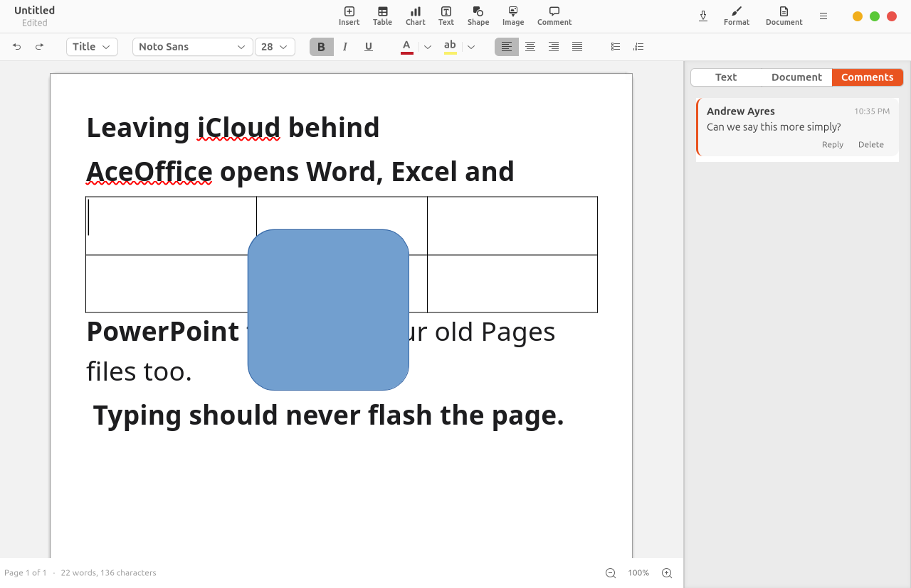
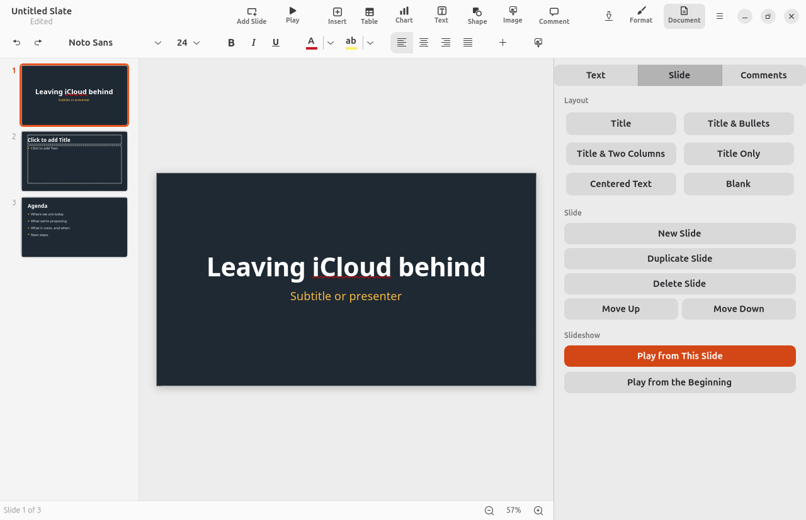
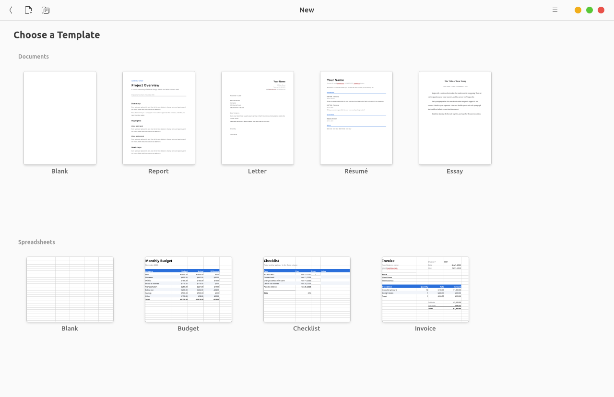
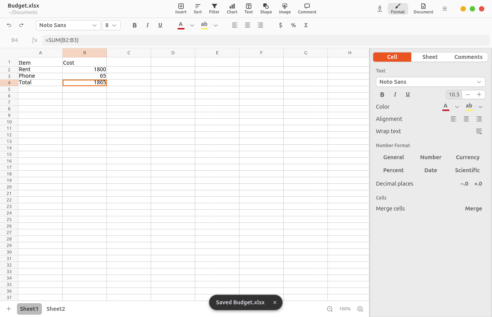

# AceOffice

A friendly office suite for Linux, made for people leaving the Apple ecosystem.

AceOffice is a native GNOME app (GTK 4 + libadwaita) that uses LibreOffice's
document engine, LibreOfficeKit, underneath. You get LibreOffice's compatibility
with Word, Excel and PowerPoint files, and its Pages, Numbers and Keynote importers, in an interface
that feels at home next to the rest of your desktop.






> **Early preview (0.2).** Documents, spreadsheets and presentations work. Presentations
> need The Document Foundation's LibreOffice, which the Flatpak includes: Ubuntu's own
> package draws slides blank through LibreOfficeKit ([#1](https://github.com/androbot9000/aceoffice/issues/1)).

## What works

- **A Mac-style start window:** your recent files and folders as page thumbnails, with search,
  and **templates** for new files (Report, Letter, Résumé, Essay; Budget, Checklist, Invoice;
  White, Black, Slate and Gradient slide themes), like Pages, Numbers and Keynote. Ctrl+N opens
  the template chooser.
- **A labelled toolbar in the title bar:** Insert (page breaks, page numbers, dates, footnotes,
  links), Table (pick the size), Chart, Text box, Shape, Image and Comment. In spreadsheets, Sort
  and Filter too; in presentations, **Add Slide** (pick a layout) and **Play** first, as in Keynote.
  **Format** and **Document** open the sidebar, as in Pages.
- **Comments** in their own sidebar tab, with replies, signed with your name.
- **Documents:** type and format text (font, size, bold, italic, underline,
  strikethrough, text color and highlight, alignment, line spacing, indents, lists,
  paragraph styles), insert images, undo and redo, spell checking. The **Format sidebar**
  (Ctrl+Shift+F) has a Document tab for paper size, orientation and margins. The status
  bar shows the page and word count.
- **Spreadsheets:** row and column headers (click one to select the whole row or column),
  values and formulas, the formula bar, sheet tabs, fill color, number formats, decimal
  places, wrap and merge, and the Σ AutoSum button. Gridlines can be hidden per sheet
  in the sidebar. Print margins, paper and orientation are in the sidebar too.
- **Presentations:** a slide navigator down the left with live thumbnails (right-click for
  New, Duplicate, Delete and Move; Delete key removes a slide), the slide fitted to the window,
  six layouts, and **Play**: full screen with a crossfade, arrows, Space or a click to move on,
  Esc to stop (Ctrl+Alt+P from this slide, F5 from the start). Animations and the file's own
  transitions aren't played yet.
- **Files:** open `.docx .doc .odt .rtf .txt .xlsx .xls .ods .csv .pptx .ppt .odp`, plus Apple
  **`.pages`**, **`.numbers`** and **`.key`** files. iWork files are imported, and the first save
  writes a Word, Excel or PowerPoint copy next to the original. New files save as
  `.docx`/`.xlsx`/`.pptx` by default (or ODF if you prefer). Export any document to PDF.
- **Everyday stuff:** find (Ctrl+F), a right-click menu, a keyboard shortcuts window
  (Ctrl+?), a recent files list, unsaved changes shown in the title (with a
  prompt before closing), the system clipboard, zoom (Ctrl + scroll), HiDPI, light
  and dark styles, and the window remembers its size.

## Try it

**As a Flatpak** (everything included: LibreOffice 26.2.7 from The Document Foundation,
and the Noto fonts the templates use):

```sh
sudo apt install flatpak flatpak-builder     # once
git clone https://github.com/androbot9000/aceoffice && cd aceoffice
tools/build-flatpak.sh                       # builds and installs it for you; --bundle also writes aceoffice.flatpak
```

**From a source checkout:**

```sh
sudo apt install python3-gi gir1.2-adw-1
tools/dev-runtime.sh         # downloads LibreOffice 26.2.7 from libreoffice.org (checksum-verified) into ~/.local/share/aceoffice
./run.sh                     # or: ./run.sh ~/Documents/report.pages
tools/install-local.sh       # optional: put AceOffice in your app grid
```

`run.sh` uses that LibreOffice when it's there; otherwise your distribution's
(`sudo apt install libreoffice-writer libreoffice-calc`), which handles documents and
spreadsheets but not slides. You can also point `ACEOFFICE_LO_PATH` at any LibreOffice
`program/` directory.

Keyboard shortcuts follow GNOME conventions. If you're coming from a Mac, use Ctrl
where you used ⌘: Ctrl+N new, Ctrl+O open, Ctrl+S save, Ctrl+Shift+S save as,
Ctrl+P export PDF, Ctrl+W close, Ctrl+B/I/U formatting, Ctrl+Z/Ctrl+Shift+Z undo/redo.

## How it works

| File | Role |
|---|---|
| `aceoffice/lok.py` | ctypes bindings for the LibreOfficeKit C API |
| `aceoffice/docview.py` | GTK 4 widget: draws LibreOffice's tiles, the caret and selections, and forwards keyboard, mouse and clipboard |
| `aceoffice/window.py` | The window: toolbar, formula bar, sheet tabs, status bar, sidebar, saving |
| `aceoffice/manager.py` | Start window (recent files with thumbnails) and the template chooser |
| `aceoffice/tools.py` | The labelled toolbar and its Insert, Table, Chart, Shape and Comment commands |
| `aceoffice/comments.py` | The Comments sidebar tab |
| `aceoffice/slides.py` | The slide navigator and Play (the full-screen slideshow) |
| `aceoffice/thumbs.py` | Page thumbnails, rendered by LibreOffice on a worker thread and cached |
| `aceoffice/templates/` | Starter templates as flat ODF, written by `tools/make-templates.py` |
| `aceoffice/headers.py` | Spreadsheet row and column headers |
| `aceoffice/inspector.py` | Formatting controls and the Format sidebar, including page setup |
| `aceoffice/widgets.py` | Colour buttons, measurement units |
| `aceoffice/macros/` | LibreOffice Basic used where LibreOfficeKit has no command (page margins) |
| `aceoffice/app.py` | Application, actions, starting the engine in the background |
| `tests/smoke.sh` | End-to-end test in a headless GNOME Shell. Creates, edits, saves and reopens files and takes screenshots (`SMOKE_THEME=1` renders with your own GTK theme) |
| `flatpak/` | The Flatpak manifest; `tools/build-flatpak.sh` builds it, `tools/unpack-libreoffice.sh` trims TDF's LibreOffice to what AceOffice uses |

LibreOffice renders each document as 256 px tiles. AceOffice caches them as GPU
textures and redraws only the tiles LibreOffice reports as changed. A changed tile stays
on screen until its replacement is ready, so typing never flashes; the smoke test checks
this frame by frame. The caret, selections and cell cursor are drawn by AceOffice on top.

Every call into LibreOfficeKit first makes its own document's view the current one (with
several documents open, LibreOffice otherwise works on whichever was used last), and
templates and thumbnails are opened from private copies, so LibreOffice never leaves a lock
file beside your documents or opens a read-only template read-only.

## Roadmap

1. **Now:** documents, spreadsheets and presentations, local files, a Flatpak.
2. **Next:** speaker notes and a presenter view, slide transitions, Share by Email to
   ACE Mail, and a bulk iWork converter (drop in a folder of Pages, Numbers and Keynote
   files and get Office or ODF copies).
3. **Cloud places in the sidebar:** iCloud Drive (via rclone, with the 2FA sign-in
   handled for you), Google Drive and OneDrive.
4. **Polish and Flathub**, and handoff with ACE Mail (open attachments in AceOffice,
   attach a document to an email).

## License

AceOffice is licensed under the [Mozilla Public License 2.0](LICENSE), the same license
as LibreOffice. AceOffice is an independent project and isn't affiliated with Apple
or The Document Foundation. Pages, Numbers and Keynote are trademarks of Apple Inc.,
mentioned only to describe file compatibility.
